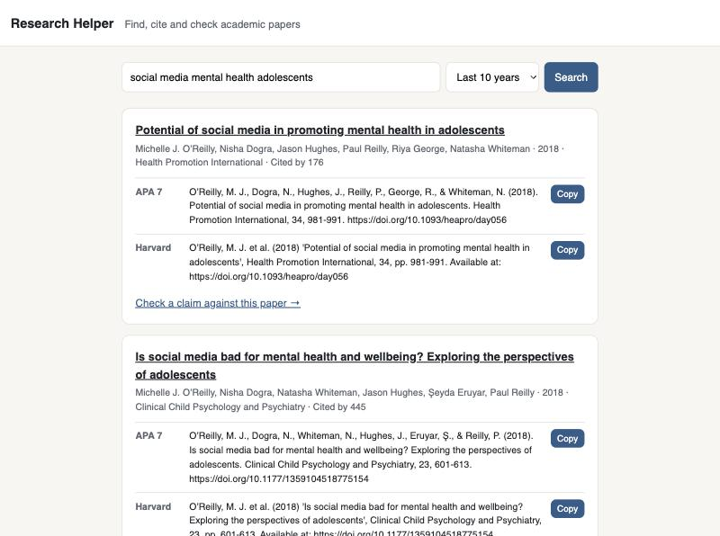
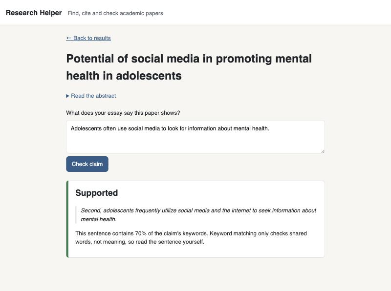

# Research Helper

A web app that helps university students **find** academic papers, **cite** them correctly, and **check** that what they say a paper shows is actually in it.



## Why I built it

Writing an essay with academic sources has three fiddly steps: finding relevant papers, getting the APA or Harvard references exactly right, and making sure you haven't cited a paper for something it doesn't say. That last one matters more now that AI chatbots can confidently invent what a source says. This app handles all three in one place.

## Features

- **Search papers:** type a topic and see every paper from [OpenAlex](https://openalex.org) (a free database of over 300 million academic works) with those words in its title, newest first, 25 at a time. Use **Older papers →** to keep going back in time, or filter to the last 5 or 10 years. Papers from the last 2 years are marked **New**.
- **Ready-made references:** every result comes with an **APA 7** and a **Harvard** reference, each with a one-click Copy button, plus the short in-text citation to use inside your essay, like *(Smith et al., 2024)*.
- **Reference list builder:** press **Save** on the papers you use, and **My references** collects them into one alphabetical list in APA or Harvard, ready to copy in one go. The list is stored in your browser, so there's no account to make.
- **Claim checker:** paste a sentence or a whole paragraph of your essay, and the app checks each sentence against the paper's abstract. Each one gets a verdict (*supported*, *partly supported*, *not supported* or *not enough info*) and the sentence from the abstract it's based on.
- **Plain-English summary (needs a Claude key):** a button that explains the paper's abstract in simple words, without jargon.



## How the claim checker works

It has two modes:

1. **Free keyword matching (default):** splits the abstract into sentences and finds the one that shares the most important words with the claim. It's free and fast, but it compares words, not meaning, so it can't tell "X improves Y" from "X does not improve Y". Because of that, it never answers "not supported" and tells you to read the sentence yourself.
2. **Claude (optional):** if an Anthropic API key is set, the app asks Claude to compare the meaning of the claim and the abstract instead. The code then double-checks that the sentence Claude quotes really appears word for word in the abstract, so the AI can't make up evidence.

Both modes only see the abstract, not the full paper. About 1 in 4 papers in OpenAlex has no abstract, so with a Semantic Scholar API key the app asks [Semantic Scholar](https://www.semanticscholar.org/product/api) for the missing ones in a single batch request. In my tests this filled in about 4 out of 10 of the gaps. If neither source has an abstract, the app says so instead of guessing.

## Tech stack

- **Python** and **Flask** for the web app
- **OpenAlex API** for paper search and details
- **Semantic Scholar API** (optional) to fill in missing abstracts
- **Anthropic Claude API** for the optional meaning-based claim check
- HTML templates (Jinja) and plain CSS

## Project structure

| File | What it does |
| --- | --- |
| `app.py` | The Flask web app: the search page and the claim-check page |
| `search_papers.py` | Talks to OpenAlex, retries when it's busy, converts results into a simple paper format, and fills missing abstracts from Semantic Scholar |
| `citations.py` | Turns paper details into APA 7 and Harvard references and in-text citations |
| `claim_checker.py` | Checks a claim (or a paragraph, sentence by sentence) against an abstract, by keywords or with Claude |
| `summary.py` | Explains an abstract in plain English with Claude |
| `templates/` | The HTML for each page |
| `static/style.css` | The site's design |

## Run it yourself

You need Python 3.12 or newer.

```bash
git clone https://github.com/michelleshibu08/uni-researcher-helper.git
cd uni-researcher-helper
python3 -m venv .venv
source .venv/bin/activate
pip install -r requirements.txt
python app.py
```

Then open **http://127.0.0.1:5001** in your browser.

### Optional: API keys

The app works without any keys. To turn on the extras, create a file called `.env` in the project folder:

```
# Fills in abstracts that OpenAlex is missing
SEMANTIC_SCHOLAR_API_KEY=your-key-here
# Uses Claude for meaning-based claim checks and plain-English summaries
ANTHROPIC_API_KEY=your-key-here
```

Get them from [Semantic Scholar](https://www.semanticscholar.org/product/api#api-key-form) and [Anthropic](https://console.anthropic.com). You can add either one, both, or neither.

Git ignores `.env`, so the key never gets uploaded.

### Command-line versions

You can also use the search and the claim checker without the website:

```bash
python search_papers.py
python claim_checker.py
```

## What I'd add next

- Put the app online so it can be used without installing anything
- Automated tests for the citation formatting and the claim checker
- More citation styles, such as MLA and Chicago
- Export the reference list as a Word document

## License

MIT. See [LICENSE](LICENSE).
