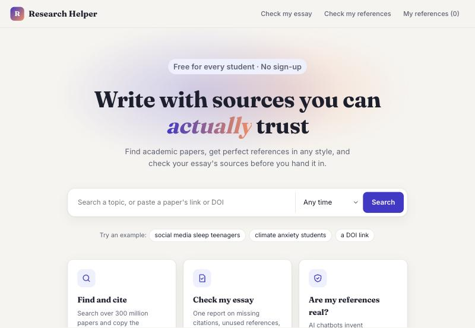
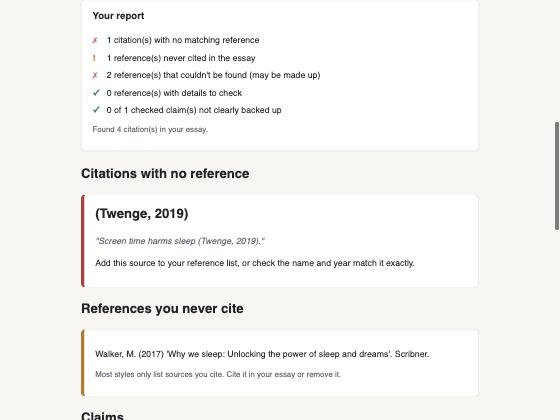

# Research Helper

A web app that helps university students **find** academic papers, **cite** them correctly, and **check** that what they say a paper shows is actually in it.



## Why I built it

Writing an essay with academic sources has three fiddly steps: finding relevant papers, getting the APA or Harvard references exactly right, and making sure you haven't cited a paper for something it doesn't say. That last one matters more now that AI chatbots can confidently invent what a source says. This app handles all three in one place.

## Features

Everything a student needs for an essay, in the order they need it:

1. **Get started:** paste your essay question and get the papers to read first: review papers that sum up the topic, the most-cited classics, the latest research, and related topics to explore.
2. **Find sources:** search over 300 million papers from [OpenAlex](https://openalex.org), newest first, or paste a paper's link or DOI. **Explore** any paper to see the papers it cites and the papers that cite it.
3. **Your essay project:** save papers to a project, mark each one *to read*, *read*, *using* or *not using*, and keep notes on it. Make as many projects as you have essays.
4. **Plan:** write your main points in order and attach the papers that support each one.
5. **Write:** a writing space with a word count and target, and an **Insert citation** button that adds the in-text citation for any saved paper.
6. **Check:**
   - **Check my essay** gives one report on citations with no reference, references you never cite, references that look made up, and claims your sources don't back up.
   - **Fake reference detector** looks every reference up to check it exists and the details match, and gives you a corrected version when they don't.
   - **Claim checker** checks a sentence or paragraph against a paper's abstract.
7. **Finish:** references in **APA 7, Harvard, MLA 9, Chicago, IEEE and OSCOLA**, and **download your essay with its reference list as a Word document**.

Free, no sign-up, no ads. Projects are saved in your own browser, and nothing you paste is stored on the server.




## How the claim checker works

It has two modes:

1. **Free keyword matching (default):** splits the abstract into sentences and finds the one that shares the most important words with the claim. It's free and fast, but it compares words, not meaning, so it can't tell "X improves Y" from "X does not improve Y". Because of that, it never answers "not supported" and tells you to read the sentence yourself.
2. **Claude (optional):** if an Anthropic API key is set, the app asks Claude to compare the meaning of the claim and the abstract instead. The code then double-checks that the sentence Claude quotes really appears word for word in the abstract, so the AI can't make up evidence.

Both modes only see the abstract, not the full paper. About 1 in 4 papers in OpenAlex has no abstract, so with a Semantic Scholar API key the app asks [Semantic Scholar](https://www.semanticscholar.org/product/api) for the missing ones in a single batch request. In my tests this filled in about 4 out of 10 of the gaps. If neither source has an abstract, the app says so instead of guessing.

## Tech stack

- **Python** and **Flask** for the web app
- **OpenAlex API** for paper search and details
- **Semantic Scholar API** (optional) to fill in missing abstracts
- **Anthropic Claude API** for the optional meaning-based claim check
- **python-docx** to build Word documents
- HTML templates (Jinja) and plain CSS

## Project structure

| File | What it does |
| --- | --- |
| `app.py` | The Flask web app: the search page and the claim-check page |
| `search_papers.py` | Talks to OpenAlex, retries when it's busy, converts results into a simple paper format, and fills missing abstracts from Semantic Scholar |
| `citations.py` | Turns paper details into references (APA 7, Harvard, MLA 9, Chicago, IEEE, OSCOLA) and in-text citations |
| `claim_checker.py` | Checks a claim (or a paragraph, sentence by sentence) against an abstract, by keywords or with Claude |
| `summary.py` | Explains an abstract in plain English with Claude |
| `essay_checker.py` | Finds the citations in an essay and builds the full report |
| `word_export.py` | Turns a reference list into a Word document |
| `research_tools.py` | Turns an essay question into papers to read first, and finds a paper's references and citations |
| `static/storage.js`, `static/project.js` | Save projects in the browser and run the project workspace |
| `verify_references.py` | Checks each reference in a list is a real paper with matching details |
| `templates/` | The HTML for each page |
| `static/style.css` | The site's design |

## Run it yourself

You need Python 3.12 or newer.

```bash
git clone https://github.com/michelleshibu08/uni-researcher-helper.git
cd uni-researcher-helper
python3 -m venv .venv
source .venv/bin/activate
pip install -r requirements.txt
python app.py
```

Then open **http://127.0.0.1:5001** in your browser.

### Optional: API keys

The app works without any keys. To turn on the extras, create a file called `.env` in the project folder:

```
# Your own OpenAlex allowance (without it, everyone on your network shares a small daily one)
OPENALEX_API_KEY=your-key-here
# Fills in abstracts that OpenAlex is missing, and double-checks references
SEMANTIC_SCHOLAR_API_KEY=your-key-here
# Uses Claude for meaning-based claim checks and plain-English summaries
ANTHROPIC_API_KEY=your-key-here
```

Get them from [OpenAlex](https://help.openalex.org/api/authentication/), [Semantic Scholar](https://www.semanticscholar.org/product/api#api-key-form) and [Anthropic](https://console.anthropic.com). All three are optional, and the OpenAlex and Semantic Scholar keys are free.

Git ignores `.env`, so the key never gets uploaded.

### Command-line versions

You can also use the search and the claim checker without the website:

```bash
python search_papers.py
python claim_checker.py
```

## What I'd add next

- Put the app online so it can be used without installing anything
- Automated tests for the citation formatting and the claim checker
- Upload an essay as a Word or PDF file instead of pasting it
- Check claims against the full text of open-access papers, not just the abstract

## License

MIT. See [LICENSE](LICENSE).
